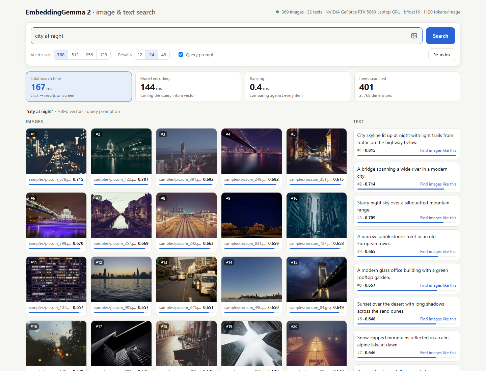
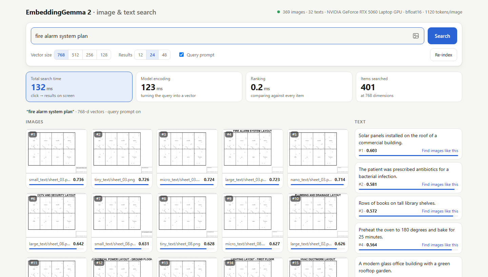

# EmbeddingGemma 2 · Local Image & Text Search

**Search your images by describing them, by example, or both, using Google's open multimodal embedding model, running entirely on your own machine.**




This project is a hands-on playground for [**EmbeddingGemma 2**](https://huggingface.co/google/embeddinggemma-2) (Google DeepMind, Oct 2026), a 740M-parameter open model that embeds **text, images, audio and video into one shared vector space**. Point it at a folder of images and you get a fast, private semantic search engine with a clean web UI, plus tools to measure what the model can and can't do.

---

## Highlights

- **Text → image search:** type *"a lonely road"* or *"something calm and peaceful"* and get matching photos, with no tags or captions needed.
- **Image → image search:** upload, paste (Ctrl+V) or drag in a picture to find visually and semantically similar ones.
- **Image + text queries:** combine a photo with words like *"at night"* or *"in winter"* to steer the search.
- **Find similar:** click any result to search from it instantly, reusing its stored vector.
- **Live speed metrics:** total time, model encoding time, ranking time and items searched, shown for every query.
- **Matryoshka vector sizes:** switch between 768 / 512 / 256 / 128 dimensions on the fly to compare quality against footprint.
- **Fine detail:** images are read at up to 1120 vision tokens. In our test the model read 8 px title text on a 2400 px technical drawing correctly every time (see [Benchmarks](#benchmarks)).
- **Incremental indexing:** only new or changed files are embedded, and everything else loads from cache.
- **Private by design:** no API keys and no cloud calls. Your images never leave your machine.

---

## Quick start

> **Requirements:** Python 3.10+, about 2 GB of disk for the model, and ideally a GPU (NVIDIA CUDA or Apple Silicon). It also runs on CPU, just more slowly.

```bash
git clone https://github.com/Mohammed123-najeh/-EmbeddingGemma-2.git embeddinggemma2-search
cd embeddinggemma2-search
```

**Windows**

```bat
setup.bat                                   :: creates .venv, installs PyTorch (CUDA if an NVIDIA GPU is found) + dependencies
.venv\Scripts\python.exe download_samples.py  :: optional: 300 sample photos
start.bat                                   :: opens http://127.0.0.1:8000
```

**Linux / macOS**

```bash
chmod +x setup.sh start.sh
./setup.sh                                  # creates .venv and installs dependencies
.venv/bin/python download_samples.py        # optional: 300 sample photos
./start.sh                                  # opens http://127.0.0.1:8000
```

The first launch downloads the model (~1.5 GB) from Hugging Face and indexes your images. Later launches start in about 20 seconds.

<details>
<summary><b>Manual installation</b></summary>

```bash
python -m venv .venv
# Windows: .venv\Scripts\activate    Linux/macOS: source .venv/bin/activate

# Windows + NVIDIA only: PyPI's Windows wheels are CPU-only, so install the CUDA build first
pip install torch torchvision --index-url https://download.pytorch.org/whl/cu130

pip install -r requirements.txt
python app.py
```

</details>

---

## Using it

| Do this | To |
|---|---|
| Type a description and press **Search** | Find images (and texts) that match the meaning |
| Click the 🖼 icon, paste an image, or drop one on the page | Search by example |
| Add an image **and** type text | Steer the image search ("at night", "aerial view") |
| Hover a result → **Find similar** | Use that result as the new query |
| Switch **Vector size** | Compare 768 / 512 / 256 / 128-dimension results instantly |
| Toggle **Query prompt** | Compare with and without the model's recommended `task: search result \| query:` prefix |
| Open `/?q=your+search` | Share or bookmark a search |

### Your own images and texts

1. Copy images into `images/` (subfolders are fine; `.jpg .jpeg .png .webp .bmp`).
2. Optionally add text documents to `texts.txt`, one per line.
3. Press **Re-index** in the app. Only new or changed files are processed.

Or point the app at any folder:

```bash
python app.py --images "D:/Projects/Drawings"
```

### Command-line options

| Option | Default | Description |
|---|---|---|
| `--images PATH` | `./images` | Folder to index (recursive) |
| `--texts PATH` | `./texts.txt` | Text documents, one per line |
| `--index PATH` | `./index` | Where embeddings and thumbnails are cached |
| `--image-tokens N` | `1120` | Vision tokens per image: `70 140 280 560 1120`. More tokens mean finer detail and slower indexing |
| `--host / --port` | `127.0.0.1 / 8000` | Server address |
| `--no-browser` | off | Don't open the browser on start |

---

## How it works

```
                    ┌──────────────────────────────┐
 images/  ────────► │                              │ ──► 768-d vectors ──► index/embeddings.npy
 texts.txt ───────► │   EmbeddingGemma 2 (740M)    │
                    │  text · image · audio · video│
 your query ──────► │                              │ ──► 768-d vector ─┐
                    └──────────────────────────────┘                   │
                                                                       ▼
                           cosine similarity against every stored vector (NumPy, < 1 ms)
                                                                       │
                                                                       ▼
                                                        ranked images  +  ranked texts
```

1. **Indexing:** each image is split into up to *N* vision tokens (patches) and embedded into a single 768-number vector. Texts get the model's document prompt (`title: none | text: …`). Vectors and thumbnails are cached and keyed by file path, size and modification time, so re-indexing only touches what changed.
2. **Querying:** text queries get the search prompt (`task: search result | query: …`). Images and image+text queries are embedded the same way as indexed images. Repeated text queries are served from an in-memory cache.
3. **Ranking:** a dot product of normalized vectors (cosine similarity) against the whole index. Images and texts are ranked separately, because text-to-text similarity is naturally higher than text-to-image similarity (the *modality gap*), so a single mixed list would push images down.
4. **Matryoshka truncation:** the model is trained so the first dimensions carry the most information. Switching to 256-d keeps the first 256 numbers of every vector (re-normalized), with no re-indexing needed.

---

## Benchmarks

Measured on a laptop: **NVIDIA RTX 5060 Laptop GPU (8 GB)**, Intel i7-13620H, Windows 11, PyTorch 2.14.1 + CUDA 13.0, bfloat16.

### Speed

| Step | Result |
|---|---|
| Model load (from local cache, incl. warm-up) | ~20 s |
| Text query → vector | typically 100–300 ms |
| Ranking ~400 items | **< 1 ms** |
| End-to-end search (click → results on screen) | typically 0.15–0.3 s |
| Indexing at 280 tokens/image | ~5 images/s |
| Indexing at 1120 tokens/image | ~1.2 images/s |
| Peak GPU memory (280 tokens/image) | ~1.9 GB |

Search time is dominated by encoding the query, while ranking is nearly free. A brute-force scan stays in the low milliseconds up to tens of thousands of items. For millions of items, plug in a vector database (FAISS, Qdrant, etc.).

### Small-detail test: can it read a technical drawing?

[`test_small_details.py`](test_small_details.py) generates 12 floor-plan sheets that are **pixel-identical except for the drawing title** in the title block ("FIRE ALARM SYSTEM LAYOUT", "HVAC DUCTWORK LAYOUT", …). The only way to find the right sheet is to read that text. The title is rendered at five sizes on a 2400 × 1700 px sheet, and each sheet is searched with a natural query such as *"fire alarm system plan"*.

**Top-1 accuracy: how often the correct sheet ranked first** (random guessing = 8%)

| Title text size | 70 tokens | 280 tokens | **1120 tokens** |
|---|:---:|:---:|:---:|
| Large banner (96 px) | 100% | 100% | **100%** |
| Small (26 px) | 83% | 100% | **100%** |
| Tiny (16 px) | 42% | 100% | **100%** |
| Micro (11 px) | 0% | 100% | **100%** |
| Nano (8 px) | 0% | 50% | **100%** |

At the maximum image budget, the model identified every sheet even when the title was **8 px tall**, which is barely legible to a person zoomed in. Lower budgets break down as the text shrinks, so **for drawings, scans and documents, use `--image-tokens 1120`** (the default).



> This is a clean, best-case test (one title, black on white). Real drawings with dense linework, many labels and scan noise are harder, so benchmark on your own data. Run `python test_small_details.py` to reproduce.

### What we observed

- **Everyday photos:** text-to-image search is strong, including abstract queries ("something calm and peaceful").
- **256-d vectors** gave almost the same rankings as 768-d at one third of the storage. At **128-d**, results start to drift.
- **Image + text queries** work, but the image tends to dominate the result.
- **Typical weak spots** for embedding models apply: negation ("without people"), counting ("three dogs") and spatial relations ("left of").

---

## Project structure

```
├── app.py                 FastAPI server, API and CLI
├── engine.py              Model loading, incremental indexing, search
├── static/index.html      Single-page search UI (no build step)
├── download_samples.py    Fetches sample photos (Unsplash via picsum.photos)
├── test_small_details.py  Small-detail / text-reading benchmark
├── texts.txt              Text documents indexed next to the images
├── setup.bat / setup.sh   One-time environment setup
├── start.bat / start.sh   Launchers (set EG2_PYTHON to use another environment)
├── requirements.txt
├── images/                Your images (git-ignored)
└── index/                 Embedding cache and thumbnails (generated, git-ignored)
```

### HTTP API

| Method & path | Description |
|---|---|
| `GET /api/status` | Model and index state, device, counts, indexing progress |
| `POST /api/search` | Form fields: `text`, `image` (file), `ref` (item id), `k`, `dim`, `use_prompt` |
| `POST /api/reindex` | Re-scan `images/` and `texts.txt`, embedding only what changed |

Interactive docs are available at `http://127.0.0.1:8000/docs`.

---

## Troubleshooting

| Problem | Fix |
|---|---|
| Status shows **CPU** on a PC with an NVIDIA GPU | PyPI ships CPU-only PyTorch for Windows. Run `setup.bat`, or install from `https://download.pytorch.org/whl/cu130` (older drivers: use `cu126` / `cu128`). RTX 50-series GPUs need CUDA 12.8 or newer. |
| `No module named 'torchvision'` | `pip install torchvision` from the same index as your PyTorch build. |
| Embeddings are NaN or results look random | Don't run the model in float16. The app uses bfloat16 or float32 automatically. |
| Hugging Face "symlinks" warning on Windows | Harmless. Enable Windows Developer Mode to silence it, or set `HF_HUB_DISABLE_SYMLINKS_WARNING=1`. |
| Port 8000 already in use | `python app.py --port 8080` |

---

## Acknowledgements

- [EmbeddingGemma 2](https://huggingface.co/google/embeddinggemma-2) by Google DeepMind, released under Apache 2.0.
- Built with [Sentence Transformers](https://www.sbert.net/), [Hugging Face Transformers](https://github.com/huggingface/transformers), [PyTorch](https://pytorch.org/) and [FastAPI](https://fastapi.tiangolo.com/).
- Sample photos from [Unsplash](https://unsplash.com/) via [Lorem Picsum](https://picsum.photos/).
